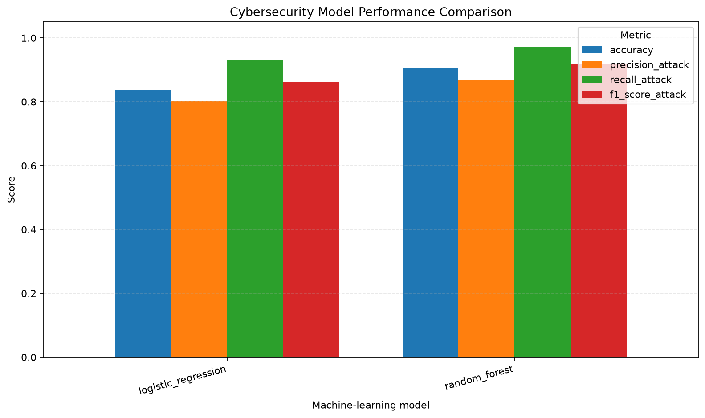
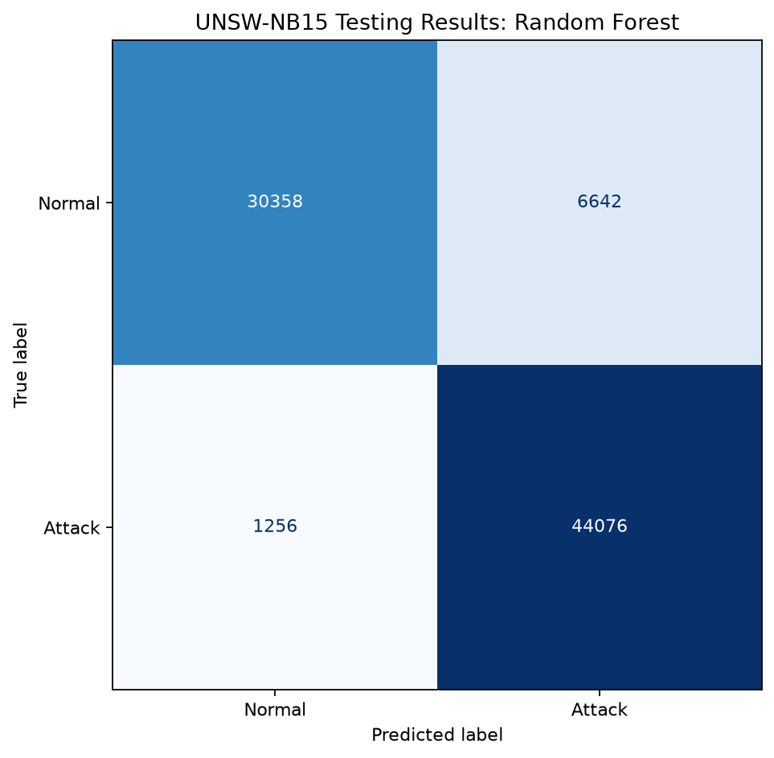
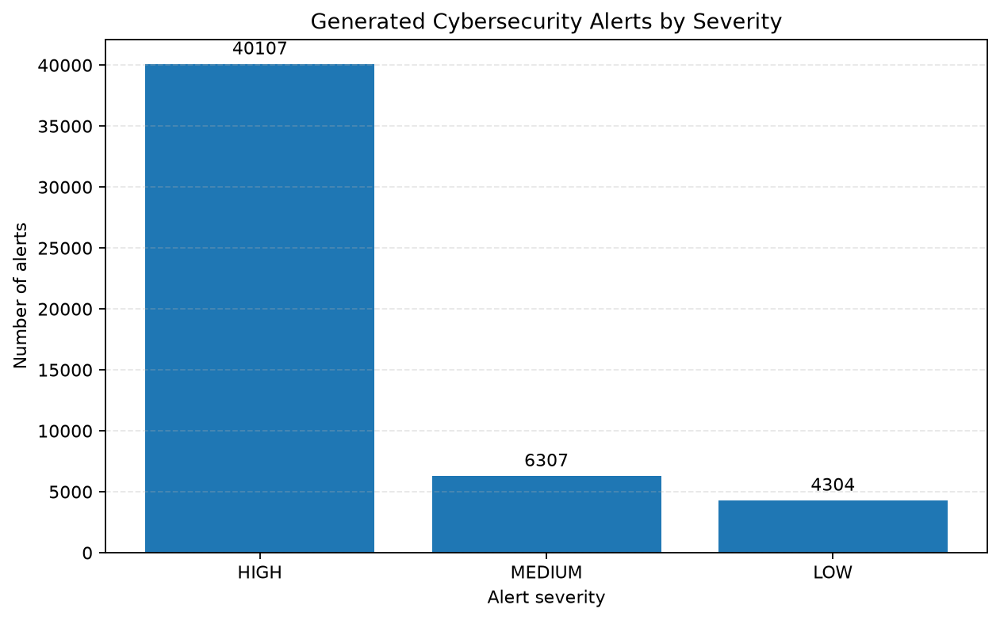
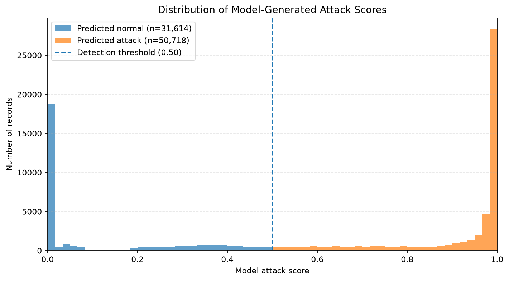
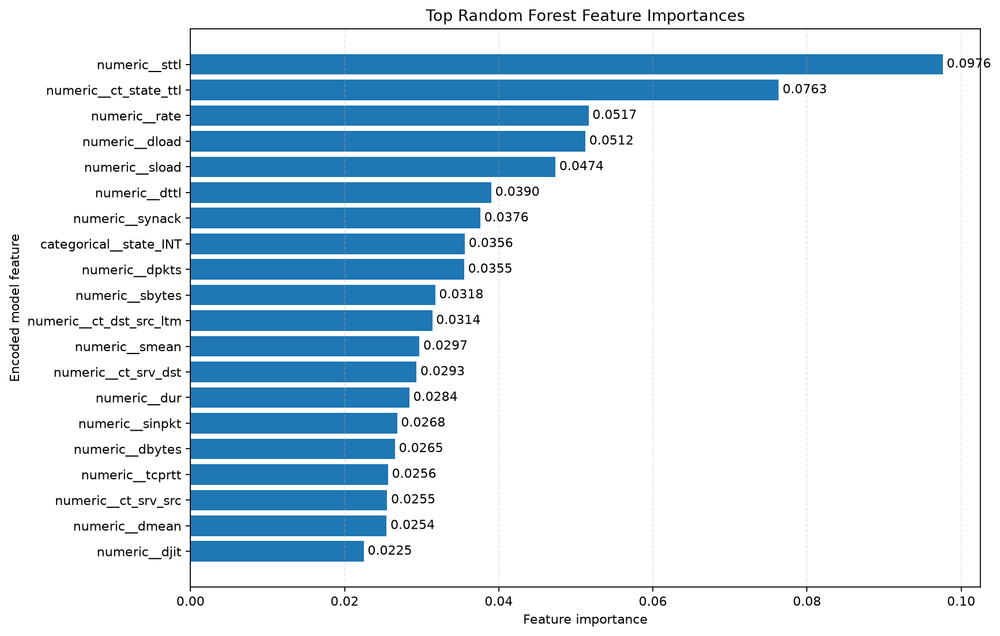

# AI-Powered Cybersecurity Threat Detection System

[](https://github.com/ayushkrdubey-23/AI-Powered-Cybersecurity-Threat-Detection/actions/workflows/tests.yml)

A machine-learning-based defensive cybersecurity project that analyzes public network traffic data, identifies records resembling known attacks, generates severity-ranked alerts, and presents evaluation results in an interactive Streamlit dashboard.

**Primary dataset:** UNSW-NB15  
**Primary models:** Logistic Regression and Random Forest  
**Mode:** Offline dataset replay and virtual threat simulation

This is an educational project. It does not require access to a corporate network and does not perform live traffic capture or automated blocking.

## Table of Contents

- [Project Overview](#project-overview)
- [Features](#features)
- [Technology Stack](#technology-stack)
- [Architecture](#architecture)
- [Dataset](#dataset)
- [Repository Structure](#repository-structure)
- [Installation](#installation)
- [Execution Guide](#execution-guide)
- [Evaluation Metrics](#evaluation-metrics)
- [Threat Detection and Severity](#threat-detection-and-severity)
- [Visual Results](#visual-results)
- [Automated Testing](#automated-testing)
- [Limitations](#limitations)
- [Learning Outcomes](#learning-outcomes)
- [Future Improvements](#future-improvements)
- [Dataset Citation](#dataset-citation)

## Project Overview

### Problem Statement

Network environments can generate large volumes of traffic records. Reviewing all records manually can be difficult, so cybersecurity teams use detection and prioritization systems to help identify activity that deserves investigation.

This project explores how supervised machine learning can distinguish normal network traffic from traffic labelled as malicious in a public research dataset.

### Objectives

- Load and inspect public network intrusion data.
- Clean and validate data before model training.
- Engineer numerical and categorical traffic features.
- Train and compare Logistic Regression and Random Forest classifiers.
- Evaluate model predictions using classification metrics.
- Generate attack scores and severity-ranked alerts.
- Visualize performance, scores, protocols, and feature importance.
- Provide a dashboard for examining detection results.
- Document the development process and automate unit tests.

## Features

- Dataset loading and data-quality summaries
- Missing-value and target-label validation
- Numerical imputation and standardization
- Categorical imputation and one-hot encoding
- Logistic Regression and Random Forest model training
- Independent testing-set evaluation
- Confusion matrices and classification reports
- Offline threat scoring and alert generation
- Low, Medium, and High alert severity
- CSV and JSON reporting
- Reproducible offline simulation
- Streamlit dashboard with filters and downloads
- Automated testing using Pytest
- GitHub Actions continuous integration

The current classifier handles binary network intrusion detection. Phishing email analysis, malware-file detection, financial fraud detection, and live network monitoring are separate capabilities and are not claimed as implemented.

## Technology Stack

| Component | Technology |
|---|---|
| Programming language | Python |
| Data processing | Pandas, NumPy |
| Machine learning | Scikit-learn |
| Models | Logistic Regression, Random Forest |
| Model persistence | Joblib |
| Visualization | Matplotlib, Seaborn |
| Dashboard | Streamlit |
| Automated testing | Pytest |
| Dataset | UNSW-NB15 CSV files |
| Version control | Git and GitHub |
| Continuous integration | GitHub Actions |

A GPU is not required for the current implementation.

## Architecture

```text
Public UNSW-NB15 Dataset
           |
           v
    Dataset Loader
           |
           v
 Data Cleaning and Validation
           |
           v
 Feature and Target Separation
           |
           v
    Feature Engineering
  Numerical      Categorical
 Imputation      Imputation
 Scaling         One-Hot Encoding
           |
           v
   Fitted Preprocessing Pipeline
           |
           v
 Logistic Regression / Random Forest
           |
           v
 Independent Model Evaluation
           |
           v
  Metrics and Confusion Matrices
           |
           v
 Offline Threat Scoring and Alerts
           |
           v
 Reports and Visualization Graphs
           |
           v
     Streamlit Dashboard
```

The fitted preprocessing transformer is reused for testing and prediction. The independent testing dataset is not used to fit the preprocessing steps or retrain the models.

## Dataset

### UNSW-NB15 Network Intrusion Detection Dataset

Official source:

https://research.unsw.edu.au/projects/unsw-nb15-dataset

Download the prepared training and testing CSV files from the official source, following the dataset provider's instructions.

Place the files directly inside `data/`:

```text
data/
├── UNSW_NB15_training-set.csv
└── UNSW_NB15_testing-set.csv
```

Important fields include:

- `label`: binary target, where 0 represents normal traffic and 1 represents attack traffic
- `attack_cat`: descriptive attack category, where available
- `id`: a record identifier
- Traffic features such as protocol, duration, connection state, packet counts, and byte counts

The precise columns are validated by the code.

### Dataset handling principles

- Keep original dataset files unchanged.
- Exclude target labels and record identifiers from predictive features.
- Fit imputation, scaling, and encoding on training data only.
- Evaluate the fitted models on the prepared testing dataset.
- Do not commit raw dataset files without checking their terms and repository size.
- Do not interpret dataset labels as confirmation of attacks on a live network.

See [`docs/dataset_guide.md`](docs/dataset_guide.md) for detailed acquisition and handling instructions.

## Repository Structure

```text
AI-Powered-Cybersecurity-Threat-Detection/
│
├── .github/
│   └── workflows/
│       └── tests.yml
│
├── app/
│   ├── __init__.py
│   └── dashboard.py
│
├── data/                         # Local dataset files; not committed
│
├── docs/
│   ├── architecture.md
│   ├── dataset_guide.md
│   ├── project_plan.md
│   ├── proof_of_work.md
│   ├── release_checklist.md
│   ├── github_publication.md
│   └── final_verification.md
│
├── images/                       # Selected visual evidence
│
├── models/                       # Locally generated model artifacts
│
├── notebooks/                    # Optional exploratory notebooks
│
├── outputs/                      # Generated reports and graphs
│
├── src/
│   ├── __init__.py
│   ├── data_loader.py
│   ├── preprocessing.py
│   ├── feature_engineering.py
│   ├── model_training.py
│   ├── model_evaluation.py
│   ├── threat_detection.py
│   ├── visualization.py
│   └── simulation.py
│
├── tests/
│   ├── test_preprocessing.py
│   ├── test_feature_engineering.py
│   └── test_threat_detection.py
│
├── .gitignore
├── main.py
├── requirements.txt
└── README.md
```

The `data/`, `models/`, and `outputs/` directories contain local or generated files. Some directories may appear only after the relevant workflow runs or files have been added.

## Installation

### 1. Clone the repository

```powershell
git clone https://github.com/ayushkrdubey-23/AI-Powered-Cybersecurity-Threat-Detection.git
cd AI-Powered-Cybersecurity-Threat-Detection
```

### 2. Create and activate the virtual environment

Recommended Python version: 3.12.

```powershell
python -m venv .venv
```

Activate it in Windows PowerShell:

```powershell
.\.venv\Scripts\Activate.ps1
```

### 3. Install dependencies

```powershell
python -m pip install --upgrade pip
python -m pip install -r requirements.txt
python -m pip check
```

### 4. Download the dataset

Download and extract the two prepared UNSW-NB15 CSV files from the official dataset source.

Verify the files in PowerShell:

```powershell
Test-Path .\data\UNSW_NB15_training-set.csv
Test-Path .\data\UNSW_NB15_testing-set.csv
```

Both commands should return `True`.

## Execution Guide

Run all commands from the project root with the virtual environment active.

### 1. Run the automated tests

```powershell
python -m pytest -v
```

### 2. Train the models

```powershell
python -m src.model_training
```

The training process creates these local artifacts:

```text
models/
├── preprocessor.joblib
├── logistic_regression.joblib
└── random_forest.joblib
```

The model artifacts are generated by the training code and are not committed by default.

### 3. Evaluate the models

```powershell
python -m src.model_evaluation
```

This produces actual testing-set metrics, classification reports, confusion matrices, and row-level predictions.

### 4. Run offline threat detection

```powershell
python -m src.threat_detection
```

The Random Forest classifier generates attack scores and alert records from the prepared testing data.

### 5. Run the reproducible simulation

```powershell
python -m src.simulation --samples-per-class 50
```

This selects a reproducible sample of normal and attack records for demonstration and post-prediction assessment. Its metrics apply to the selected sample, not to real-world attack prevalence.

### 6. Generate visualizations

```powershell
python -m src.visualization
```

The generated graphs are saved under `outputs/visualizations/`.

### 7. Launch the Streamlit dashboard

```powershell
python -m streamlit run app/dashboard.py
```

Open the local URL printed by Streamlit, normally:

http://localhost:8501

The dashboard reads the saved evaluation and detection reports. It does not train models automatically.

### 8. Run the root entry point

```powershell
python main.py
```

The current root entry point invokes the visualization workflow. Use the dedicated module commands above to run training, evaluation, simulation, and detection separately.

## Evaluation Metrics

The system reports:

- Accuracy
- Precision for the attack class
- Recall for the attack class
- F1 score for the attack class
- Balanced accuracy
- False-positive rate
- Confusion matrix

Accuracy describes the proportion of correct predictions.

Attack precision measures the proportion of predicted attacks that match attack labels in the evaluated dataset.

Attack recall measures how many attack-labelled records are detected.

The false-positive rate measures the proportion of normal-labelled records incorrectly classified as attacks.

Actual metrics must be taken from generated experiment results. No performance values are assumed in advance.

## Threat Detection and Severity

The offline threat detection module uses the Random Forest model's class-1 output as an attack score.

Configured demonstration thresholds:

| Score | Result |
|---|---|
| Below 0.50 | No alert |
| 0.50 to below 0.65 | Low |
| 0.65 to below 0.85 | Medium |
| 0.85 and above | High |

These thresholds are configurable project heuristics, not validated production security policies.

A model score is not automatically a calibrated probability that a system has been compromised. A generated alert requires investigation and corroborating evidence.

The system does not block traffic or perform automated incident response.

## Visual Results

The following images are intended to show actual results generated by the project:

### Model performance



### Random Forest confusion matrix



### Alert severity



### Attack-score distribution



### Feature importance



If a graph does not appear on GitHub, verify that the corresponding PNG file exists in `images/` and has been committed.

## Automated Testing and Continuous Integration

Run the unit tests locally:

```powershell
python -m pytest -v
```

Check Python syntax:

```powershell
python -m compileall -q main.py src app tests
```

The repository also contains a GitHub Actions workflow at `.github/workflows/tests.yml`.

The workflow installs dependencies, checks Python syntax, and runs the tests when triggered by a push or pull request targeting `main`. The status badge at the top of this README links to the workflow history.

## Limitations

- The implementation processes an offline public dataset.
- It does not capture live network packets or monitor production infrastructure.
- Model predictions can produce false positives and false negatives.
- A predicted attack is not proof of a confirmed security incident.
- Attack scores should not be interpreted as calibrated compromise probabilities.
- The current system does not independently classify arbitrary malware files, phishing emails, or financial fraud.
- Detection thresholds require further evaluation before any operational use.
- Serialized Joblib artifacts should only be loaded from trusted sources.

This is an educational defensive analytics project, not a replacement for an enterprise SIEM, intrusion prevention system, or professional incident-response workflow.

## Learning Outcomes

This project demonstrates practical experience with:

- Cybersecurity dataset preparation
- Supervised machine learning
- Data preprocessing and feature engineering
- Target-leakage prevention
- Model evaluation and error analysis
- Threat scoring and alert generation
- Security visualization
- Streamlit dashboard development
- Automated unit testing
- Git version control and GitHub Actions

## Future Improvements

- Validation-based threshold selection
- Probability calibration
- Multi-class attack-category classification
- Isolation Forest anomaly detection
- Additional public cybersecurity datasets
- Time-window aggregation and event correlation
- Individual-alert explainability
- Expanded integration tests
- Improved reproducibility and model-version tracking

Future improvements should be documented separately from implemented and tested functionality.

## Dataset Citation

Consult the official UNSW-NB15 dataset documentation for the original research citation, dataset access, usage terms, and attribution requirements:

https://research.unsw.edu.au/projects/unsw-nb15-dataset

## Repository

https://github.com/ayushkrdubey-23/AI-Powered-Cybersecurity-Threat-Detection
