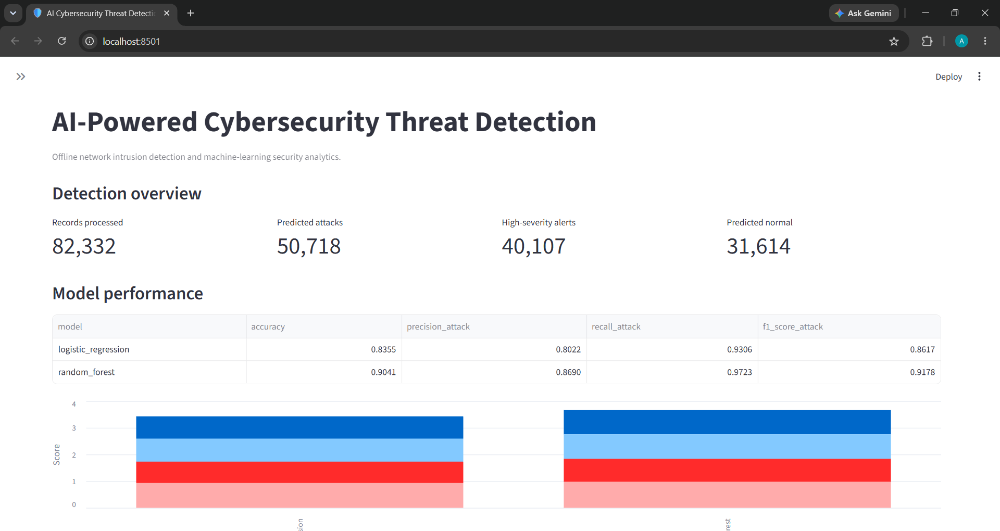

# AI-Powered Cybersecurity Threat Detection System

A machine-learning-based defensive cybersecurity project that analyzes network traffic records, classifies potential attacks, generates security alerts, and visualizes detection results through an interactive dashboard.

The project uses the public **UNSW-NB15 network intrusion detection dataset** and an offline dataset-replay workflow. It does not require access to a corporate network or production security infrastructure.

## Project Overview

### Problem Statement

Network environments generate large volumes of traffic records. Reviewing every record manually can be difficult, and security analysts need ways to prioritize suspicious activity.

This project explores how machine learning can support network intrusion detection by distinguishing normal traffic from traffic that resembles known attacks.

### Objectives

- Load and inspect a public network intrusion detection dataset.
- Clean and preprocess network traffic records.
- Transform numerical and categorical traffic features.
- Train and compare Logistic Regression and Random Forest classifiers.
- Evaluate models with accuracy, precision, recall, F1 score, balanced accuracy, and false-positive rate.
- Generate model-based attack scores and severity-ranked alerts.
- Visualize evaluation results and detection activity.
- Provide an interactive Streamlit dashboard.
- Maintain reproducible source code, tests, and Git checkpoints.

### Project Scope

The current implementation focuses on **binary network intrusion detection**:

- `0`: Normal traffic
- `1`: Attack traffic

Phishing email classification, malware-file detection, financial fraud detection, and live network monitoring are separate capabilities. This project does not claim to implement them.

## Key Features

- Dataset loading and initial inspection
- Missing-value and label validation
- Numerical feature imputation and standardization
- Categorical feature encoding
- Logistic Regression baseline classifier
- Random Forest classifier
- Independent testing-set evaluation
- Confusion matrices and classification reports
- Offline threat scoring and alert generation
- Low, Medium, and High severity categories
- CSV and JSON output reports
- Security analytics visualizations
- Streamlit dashboard with filtering and downloadable reports
- Pytest automated tests

## Technology Stack

| Component | Technology |
|---|---|
| Programming language | Python |
| Data processing | Pandas, NumPy |
| Machine learning | Scikit-learn |
| Model persistence | Joblib |
| Visualization | Matplotlib, Seaborn |
| Dashboard | Streamlit |
| Testing | Pytest |
| Dataset format | CSV |
| Version control | Git and GitHub |

## System Architecture

```text
             UNSW-NB15 Dataset
                      |
                      v
             Dataset Loader
                      |
                      v
          Data Cleaning and Validation
                      |
                      v
              Feature Separation
                      |
                      v
       Numerical and Categorical Pipeline
          |                           |
          v                           v
     Median Imputation          One-Hot Encoding
     Standardization
          |                           |
          +-------------+-------------+
                        |
                        v
             Fitted Feature Transformer
                        |
                        v
              Machine-Learning Models
              /                     \
             v                       v
      Logistic Regression       Random Forest
              \                     /
               \                   /
                v                 v
               Independent Evaluation
                        |
                        v
          Metrics and Confusion Matrices
                        |
                        v
              Offline Threat Detection
                        |
                        v
               Severity-Based Alerts
                        |
                        v
             Reports and Visualizations
                        |
                        v
                 Streamlit Dashboard
```

The preprocessing and machine-learning modules are separated so that transformations can be fitted using training data and reused during inference.

## Dataset

### UNSW-NB15

The project uses the prepared UNSW-NB15 training and testing CSV files.

Official source:

https://research.unsw.edu.au/projects/unsw-nb15-dataset

Expected local structure:

```text
data/
├── UNSW_NB15_training-set.csv
└── UNSW_NB15_testing-set.csv
```

The dataset includes normal network traffic and multiple attack categories.

Download and extract the prepared CSV files according to the provider's instructions. Place them in `data/` using the exact filenames shown above.

The initial implementation uses the following fields where available:

- `label`: binary normal/attack target
- `attack_cat`: descriptive attack category
- `id`: record identifier
- Network traffic fields such as protocol, duration, packet counts, byte counts, and connection state

The exact columns are inspected at runtime.

### Dataset Handling

- Original CSV files are kept separate from generated outputs.
- The target label is excluded from model input features.
- Attack-category descriptions and record identifiers are excluded from the initial binary classifier's predictive features.
- Feature transformations are fitted on training data only.
- Model evaluation uses the prepared testing dataset.
- Raw datasets are excluded from Git by `.gitignore`.

Consult `docs/dataset_guide.md` for dataset acquisition and handling details.

## Repository Structure

```text
AI-Powered-Cybersecurity-Threat-Detection/
│
├── app/
│   ├── __init__.py
│   └── dashboard.py
│
├── data/
│   └── .gitkeep
│
├── docs/
│   ├── architecture.md
│   ├── dataset_guide.md
│   └── project_plan.md
│
├── images/
│   └── .gitkeep
│
├── models/
│   └── Local model artifacts are generated here
│
├── notebooks/
│
├── outputs/
│   └── Generated reports and graphs
│
├── src/
│   ├── __init__.py
│   ├── data_loader.py
│   ├── preprocessing.py
│   ├── feature_engineering.py
│   ├── model_training.py
│   ├── model_evaluation.py
│   ├── threat_detection.py
│   └── visualization.py
│
├── tests/
│   ├── test_preprocessing.py
│   ├── test_feature_engineering.py
│   └── test_threat_detection.py
│
├── .gitignore
├── main.py
├── requirements.txt
└── README.md
```

Generated model files and output reports are stored locally and are not necessarily tracked by Git. Refer to `.gitignore` before publishing artifacts.

## Requirements

- Python 3.11 or 3.12 recommended
- Git
- Visual Studio Code or another Python editor
- Internet connection for installing packages and downloading the dataset
- Sufficient RAM to process the prepared CSV files and train the models

A GPU is not required for the current implementation.

## Installation

### 1. Clone the repository

After publishing the project to GitHub, clone it with:

```powershell
git clone https://github.com/YOUR-GITHUB-USERNAME/AI-Powered-Cybersecurity-Threat-Detection.git
cd AI-Powered-Cybersecurity-Threat-Detection
```

Replace `YOUR-GITHUB-USERNAME` with the actual GitHub username.

If you are already working in the project directory, skip cloning.

### 2. Create the virtual environment

Windows PowerShell:

```powershell
python -m venv .venv
```

Activate it:

```powershell
.\.venv\Scripts\Activate.ps1
```

If activation is blocked by PowerShell policy, use an appropriate process-scoped workaround rather than changing system-wide settings.

### 3. Install dependencies

```powershell
python -m pip install --upgrade pip
python -m pip install -r requirements.txt
```

Verify dependency compatibility:

```powershell
python -m pip check
```

### 4. Download the dataset

Obtain the prepared training and testing CSV files from the official UNSW-NB15 dataset source and place them in `data/`.

Confirm that the files exist:

```powershell
Test-Path .\data\UNSW_NB15_training-set.csv
Test-Path .\data\UNSW_NB15_testing-set.csv
```

Both commands should return `True`.

## How to Run

Run the commands from the project root with the virtual environment activated.

### 1. Train the models

```powershell
python -m src.model_training
```

This command fits the preprocessing transformer and trains the Logistic Regression and Random Forest classifiers.

Generated local artifacts:

```text
models/
├── preprocessor.joblib
├── logistic_regression.joblib
└── random_forest.joblib
```

### 2. Evaluate the models

```powershell
python -m src.model_evaluation
```

This command applies the saved transformer to the independent testing dataset and produces model metrics, confusion matrices, and prediction reports.

### 3. Run the offline threat detection simulation

```powershell
python -m src.threat_detection
```

The Random Forest model generates attack scores and predicted classifications for the prepared testing records.

Generated local outputs include:

```text
outputs/
├── detection_results.csv
├── threat_alerts.csv
└── detection_summary.json
```

### 4. Generate visualizations

```powershell
python -m src.visualization
```

Generated visualization files are saved to:

```text
outputs/visualizations/
```

### 5. Run the interactive dashboard

```powershell
python -m streamlit run app/dashboard.py
```

Open the local URL printed by Streamlit, typically:

http://localhost:8501

The dashboard reads the reports generated by the earlier commands. It does not retrain the models automatically.

### 6. Run the project entry point

```powershell
python main.py
```

The current root entry point runs the visualization workflow. Use the dedicated module commands above when training, evaluating, or performing detection.

## Automated Testing

Run the test suite:

```powershell
python -m pytest -v
```

Run syntax checks:

```powershell
python -m compileall -q main.py src app tests
```

The automated tests cover:

- Dataset preprocessing and target validation
- Separation of features and labels
- Handling of missing numerical and categorical values
- Encoding of previously unseen categories
- Detection-score interpretation
- Alert severity thresholds
- Detection report generation

The synthetic unit tests do not replace evaluation on the actual UNSW-NB15 testing dataset.

## Evaluation Metrics

The project reports:

- Accuracy
- Precision for the attack class
- Recall for the attack class
- F1 score for the attack class
- Balanced accuracy
- False-positive rate
- Confusion matrix

Accuracy measures the proportion of correct predictions.

Attack precision measures how many predicted attacks were actually labelled as attacks in the testing dataset.

Attack recall measures how many labelled attacks the model detected.

The false-positive rate measures the proportion of labelled normal records incorrectly predicted as attacks.

No metric values are stated here because they must be generated from the actual local model run.

## Detection and Alert Logic

The offline detection module uses the Random Forest model's class-1 output to produce attack scores.

The demonstration thresholds are:

| Score | Result |
|---|---|
| Below 0.50 | No alert |
| 0.50 to below 0.65 | Low |
| 0.65 to below 0.85 | Medium |
| 0.85 and above | High |

These thresholds are configurable project heuristics. They have not been validated as production security policies.

A model score is not automatically a calibrated probability of a real compromise. A generated alert should be treated as an event for investigation, not as confirmed proof of malicious activity.

## Generated Outputs

Depending on which commands have been executed successfully, `outputs/` may contain:

```text
outputs/
├── classification_report.txt
├── confusion_matrix_logistic_regression.png
├── confusion_matrix_random_forest.png
├── model_comparison.csv
├── evaluation_results.json
├── predictions.csv
├── detection_results.csv
├── threat_alerts.csv
├── detection_summary.json
└── visualizations/
    ├── model_metrics_comparison.png
    ├── alert_severity_distribution.png
    ├── attack_score_distribution.png
    ├── protocol_alert_counts.png
    └── random_forest_feature_importance.png
```

Not all files exist immediately after installation. Generate the corresponding outputs by completing the required pipeline stages.

## Screenshots and Demonstration

Place selected project screenshots in `images/`.

Recommended evidence:

1. Dataset inspection output
2. Preprocessing and feature engineering summary
3. Successful model training output
4. Evaluation metrics and confusion matrices
5. Threat alert preview
6. Generated visualization graphs
7. Running Streamlit dashboard
8. Successful Pytest results
9. GitHub repository overview

When screenshots are captured, include them here using Markdown image links. For example:

```markdown

```

Only include screenshots that actually exist in the repository.

## Security and Research Limitations

- The project processes an offline public dataset rather than live network traffic.
- Predictions depend on the dataset, its labels, feature selection, and model training process.
- The model can produce false positives and false negatives.
- The detection score is not guaranteed to be calibrated.
- An alert does not confirm an incident.
- The dashboard does not block connections or execute automated remediation.
- The current implementation does not independently detect arbitrary malware files, phishing emails, or financial fraud.
- Generated Joblib artifacts should only be loaded from trusted sources.
- Raw datasets should not be redistributed without reviewing the provider's terms.

This is an educational defensive analytics project, not a replacement for an enterprise SIEM, intrusion prevention system, or professional incident-response process.

## Learning Outcomes

Through this project, the developer practices:

- Preparing and validating cybersecurity datasets
- Building supervised machine-learning pipelines
- Preventing target leakage
- Applying consistent preprocessing to unseen data
- Evaluating binary classifiers
- Understanding false positives and false negatives
- Creating threshold-based security alerts
- Visualizing security-related results
- Building a Streamlit application
- Writing automated tests
- Using Git to document development stages

## Future Improvements

Potential extensions include:

- Threshold tuning using validation data
- Model calibration and additional evaluation
- Multi-class attack-category classification
- Anomaly detection with Isolation Forest
- Additional supported cybersecurity datasets
- Time-window aggregation and event correlation
- Better explainability for individual alerts
- A more advanced incident investigation workflow
- CI testing through GitHub Actions
- A reproducible experiment configuration

Future work should be documented separately from currently implemented features.

## Dataset Citation

Consult the official UNSW-NB15 dataset documentation for the original research citation, usage terms, and attribution requirements:

https://research.unsw.edu.au/projects/unsw-nb15-dataset

## License

A repository license has not been selected automatically. Before publishing a license, verify that it is appropriate for your source code and does not conflict with dataset terms.

---

**Project:** AI-Powered Cybersecurity Threat Detection System  
**Mode:** Offline dataset-based defensive simulation  
**Primary dataset:** UNSW-NB15  
**Primary models:** Logistic Regression and Random Forest
